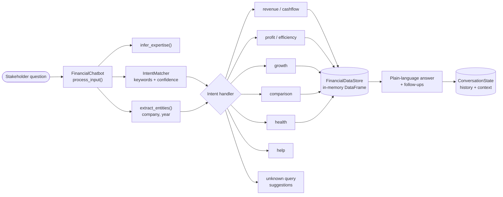
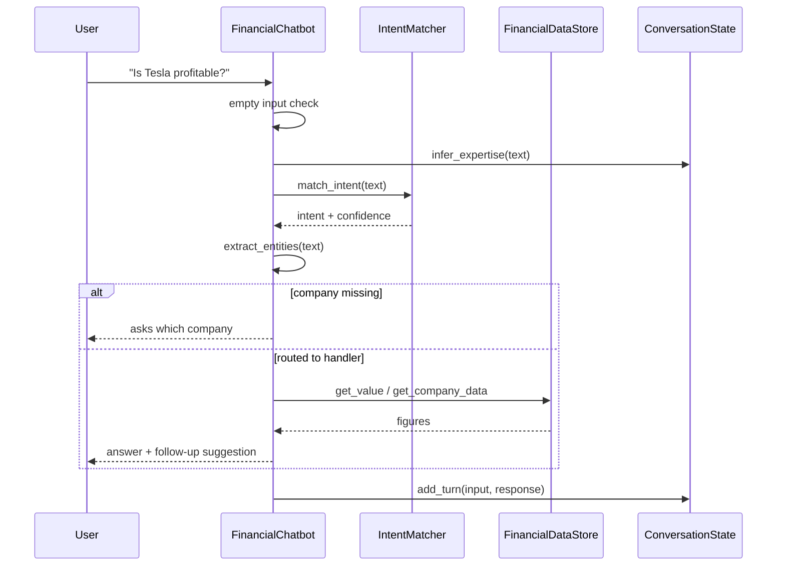

<div align="center">

# Financial Chatbot (BCG X GenAI Job Simulation)

**A rule-based conversational assistant that turns Microsoft, Tesla and Apple financials into plain-language answers.**

    

</div>

<p align="center">
  
</p>

> **Status: simulation deliverable, not deployed.** Built for the BCG X GenAI job simulation (Forage). The chatbot uses keyword intent matching, not an LLM. Its data is a hardcoded 9-row table (3 companies x 3 fiscal years), so it is a design exercise, not a financial-analysis product.

Last updated: 2026-11-03.

---

## Problem

The simulation brief asks for an assistant that makes a fictional client's (Global Finance Corp) financial data understandable to non-technical stakeholders. Task 1 analyses the numbers; Task 2 wraps them in a conversational interface with predictable, auditable behaviour.

## Design principles (Task 2)

| Principle | Where it lives in `advanced_financial_chatbot.py` |
|---|---|
| Rule-based logic | `IntentMatcher` scores keyword lists for 8 intents: revenue, profit, growth, comparison, health, efficiency, cashflow, help. |
| State management | `ConversationState` keeps history, last company/metric/year context and an inferred `user_expertise_level`. |
| Error handling | Unknown or low-confidence input goes to `handle_unknown_query`, which returns example questions; empty input gets a prompt. |
| Plain-language output | `simplify_number` and `format_financial_insight` produce short, level-aware answers. |
| Interactive dialogue | Answers end with follow-up suggestions. |
| Deterministic numbers | Every figure is computed from the in-memory DataFrame, so there is no model to hallucinate values. |

---

## Repository layout

```
BCGX-GenAI/
├── advanced_financial_chatbot.py       chatbot (CLI), 528 lines
├── Financial_Analysis_Task1 (1).ipynb  Task 1: analysis and charts
├── financial_data.xlsx                 the same dataset as a spreadsheet
├── ADVANCED_CHATBOT_GUIDE.md           long design guide for the chatbot
└── README.md
```

Classes in the script: `ConversationState`, `FinancialDataStore`, `IntentMatcher`, `FinancialChatbot`.

---

## Tech stack

| Area | Choice |
|---|---|
| Language | Python 3 (the guide states 3.7+; not verified) |
| Data | `pandas`, `numpy` |
| Text handling | `re` and plain string matching, no NLP library |
| Task 1 notebook | pandas, numpy, matplotlib, seaborn (written for Google Colab) |
| Data source (per notebook) | SEC EDGAR 10-K filings, manually extracted, units in millions of USD |

---

## System architecture



## Flow: one dialogue turn



Note on routing in the code: `cashflow` is handled by `handle_revenue_query` and `efficiency` by `handle_profit_query`, so there is no dedicated cash-flow handler despite the guide listing one.

---

## Data

Nine records, fields `Total Revenue`, `Net Income`, `Total Assets`, `Total Liabilities`, `Operating Cash Flow` (millions USD) for Microsoft, Tesla and Apple, fiscal years 2023-2025. The numbers are hardcoded in `FinancialDataStore.load_financial_data()` and repeated in the notebook; `financial_data.xlsx` is only read by the last cell of the notebook (Colab path `/content/financial_data.xlsx`), not by the chatbot. The notebook states they were manually extracted from SEC 10-K filings; I did not re-verify them against the filings.

## Run

```bash
python advanced_financial_chatbot.py
```

This starts an interactive CLI (`quit` to exit, `help` for examples). The script imports `pandas` and `numpy`, which must already be installed (the guide suggests `pip install pandas numpy`). No `requirements.txt` exists. The notebook is meant to run in Google Colab or Jupyter.

## Testing and evaluation

There is no automated test suite. `ADVANCED_CHATBOT_GUIDE.md` lists 8 manually executed scenarios, all marked PASS. Treat those results as the author's manual check only: I did not run the chatbot, and the guide's other figures (for example "95%+ intent accuracy", "<100ms", "3.2x deeper queries", "100% data accuracy") have no supporting test or measurement in the repository and should not be relied on.

## Limitations and known issues

- Known bug (read from the code, not run): `simplify_number` assumes raw dollars, but the data is in millions. A value like `281724` (millions) meets the `>= 1_000` branch and renders as `$281.7M`, whereas the guide's examples show `$281.7B`. Fixing it means treating inputs as millions (>= 1,000 is billions).
- Keyword matching only; no synonyms, typos or multi-intent handling. Three companies and three years only, no live data, no forecasting.
- The guide describes itself as "production ready", but this repo is a simulation deliverable with no deployment, auth or logging.
- The guide's Client name (Global Finance Corp) is the simulation's fictional client.

## Security and privacy

No network calls, API keys or personal data. All inputs stay in the local process.

## License

No license file is present. Treat as all rights reserved.
